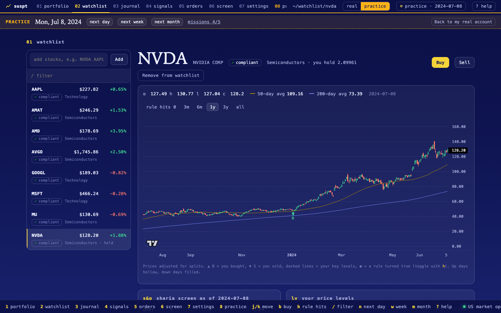
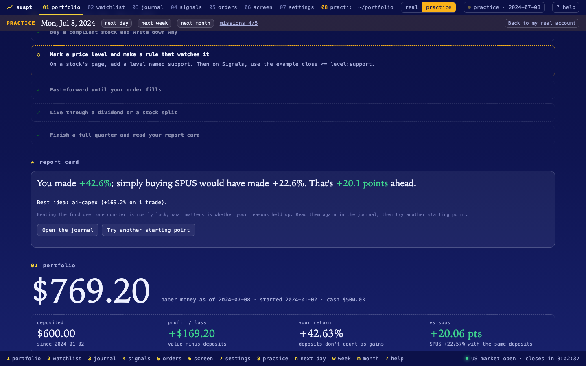
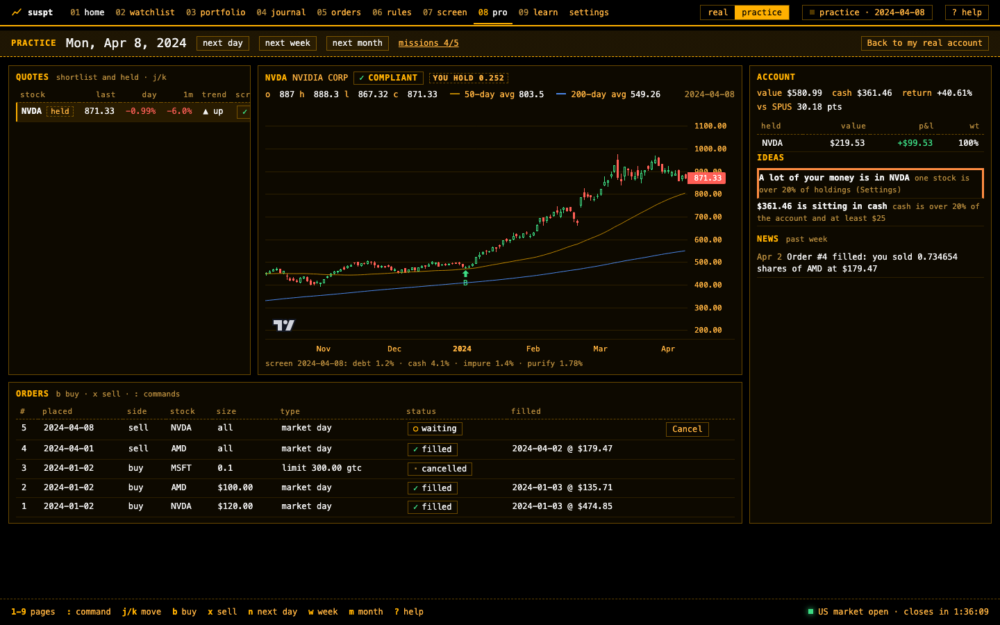
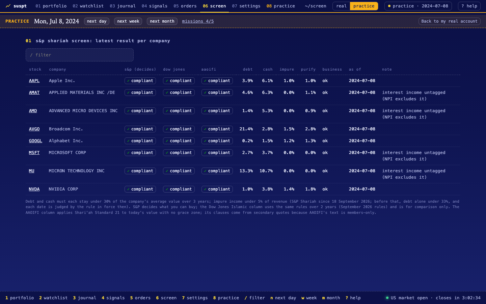

# suspt


A Sharia-compliant US stock tracker. Simulation only: no brokerage, no real orders. Made for learning purposes only.

suspt gives you pretend money, real US stock prices and a Sharia screen built from companies' own SEC filings. You buy and sell with a written reason for every trade, and suspt shows you, month after month, which of your reasons actually worked and whether you beat simply buying a Sharia index fund.



## What it does

- **Sharia screen from primary sources.** Every company is screened with the S&P Shariah rules (debt, cash and impure income limits, with S&P's grace buffer), computed from SEC filings. Dow Jones Islamic and AAOIFI Standard 21 are shown side by side for comparison.
- **Paper trading that stays honest.** Orders fill at a later market open, never at a price you have already seen. Fractional shares, limit and good-till-cancelled orders, fees, dividend tax, splits.
- **A reason for every trade.** Each order needs a written reason and a short thesis tag. The journal scores every idea by what it really returned, dividends included.
- **Compliance that acts.** Only compliant stocks can be bought. If one you hold stops being compliant, suspt sells it for you (or warns you, if you prefer).
- **Purification.** Each dividend's impure share is calculated and set aside automatically.
- **A fair benchmark.** Your result is compared with SPUS, the S&P 500 Shariah fund, given the same deposits on the same dates.
- **Rules you can read.** Plain conditions such as `close crosses_above sma200` flag buy ideas; editing a rule keeps its earlier versions. Nothing is a black box.
- **A home page that keeps watch.** Your shortlist and holdings as small charts, what changed since your last visit (fills, dividends, compliance changes, your levels and rules), and ideas worked out from plain rules, each one saying which rule produced it. No predictions, no "buy now".
- **A path from beginner to advanced.** Short lessons that finish when you do the thing. Your level decides which pages are in the menu, so a beginner sees five and the rest arrive when they're useful.
- **Three looks.** Night, day, and a black-and-amber terminal theme. Advanced users get a pro view with quotes, chart, account, news and orders on one screen, and a command bar (`:` or Ctrl+K): `NVDA`, `BUY NVDA 50`, `SELL NVDA ALL`, `PORT`, `THEME DAY`.
- **A time machine.** Practice mode starts an account in the past, shows you only what was known on that day, and lets you fast-forward a day, week or month at a time. Missions walk a new user through it and a report card closes each quarter.





## Get started (no terminal needed)

1. Install Go once from <https://go.dev/dl/>. suspt builds itself with it.
2. Download this repository (green **Code** button, **Download ZIP**) and unzip it.
3. Double-click **`Suspt.command`**. The first time, macOS may block it because it was downloaded: right-click it, choose **Open**, then **Open** again. It builds suspt and opens it in your browser.
4. Follow **getting started** on the first page: connect the two free data sources, pick stocks, place your first paper trade.

Keep the small window that opens; closing it stops suspt. While it runs, new prices arrive by themselves after each US market close.

Want to learn first? Press **practice** at the top and pick a starting point, such as *The 2024 AI run-up*.

### Data sources

| | What for | Cost |
|---|---|---|
| [Tiingo](https://www.tiingo.com/) | Daily prices, dividends and splits | Free account; 50 requests per hour, personal use only |
| [SEC EDGAR](https://www.sec.gov/search-filings/edgar-application-programming-interfaces) | Company filings for the Sharia screen | Free; asks for your name and email on every request |
| [SPUS holdings](https://www.sp-funds.com/spus/) | Which stocks S&P's own Sharia fund holds | Free daily file |

Both keys are entered once on the Settings page and stay in a `.env` file on your computer.

## How the Sharia screen works



| | S&P Shariah (decides) | Dow Jones Islamic (compare) | AAOIFI Standard 21 (compare) |
|---|---|---|---|
| Debt | under 30% | under 30% | not over 30% |
| Cash and interest-bearing securities | under 30% | under 30% | not over 30% (deposits) |
| Measured against | 36-month average market value | 24-month average market value | today's market value |
| Impure income | under 5% of revenue | under 5% of revenue | not over 5% of income |
| Grace buffer | 2 points, 3 periods | 2 points, 3 periods | none |
| Source | [Methodology, Oct 2026](https://www.spglobal.com/spdji/en/documents/methodologies/methodology-sp-shariah-indices.pdf) | [Methodology, Sep 2026](https://www.spglobal.com/spdji/en/documents/methodologies/methodology-dj-islamic-market-indices.pdf) | Clauses 3/4/2 to 3/4/5 via [secondary quotes](https://halal.ninja/what-is-aaoifi); AAOIFI's text is members-only |

- **Rules by date.** S&P and Dow Jones both changed on 18 September 2026; before that the only ratio test was debt under 33%. Every month is judged by the rule in force then, so the grace buffer carries stocks across the change the way the indices do.
- **No hindsight.** A month's screen only uses filings already published that month. The screen runs monthly; the current month is shown but only counts once it is complete.
- **Business activity.** Banks, insurers, alcohol, tobacco and similar industries are excluded from the SEC industry code. Ambiguous codes (beverages, restaurants, media) need your verdict, and a stock that S&P's own fund doesn't hold is flagged for review: that catches what an industry code can't see.
- **Checked against reality.** On SPUS's actual holdings, the S&P screen agrees except where a ratio sits within a point of the limit, because S&P's data provider measures slightly differently from SEC figures. Those cases are labelled.

## How the simulation works

- Your orders and settings are the only stored inputs. Everything else (fills, holdings, history) is rebuilt from scratch on every run, so it can't drift.
- An order placed today fills at a later market open: market orders at the open, limit orders when the price is reached.
- Deposits default to $300 to start plus $50 a month; fees and dividend tax are configurable for your broker.
- Returns are time-weighted, so deposits don't count as gains. Holdings are tracked lot by lot, oldest first, so each sale's profit traces back to the reason you bought.

## For terminal users

Everything in the app is also a command:

```sh
cp .env.example .env     # add TIINGO_API_KEY and SEC_USER_AGENT
go build -o suspt .
./suspt                  # open the app
./suspt update           # fetch, screen, replay, report
./suspt buy NVDA -usd 50 -reason "data-center demand keeps growing" -thesis ai-capex
./suspt sell NVDA all -reason "too concentrated" -thesis risk
./suspt rule add golden-cross '*' WATCH trend "sma50 crosses_above sma200"
./suspt screen           # all three standards for every company
./suspt help             # every command
```

## Under the hood

One Go binary and one SQLite file, with no framework and one dependency ([modernc.org/sqlite](https://pkg.go.dev/modernc.org/sqlite)). The web app is plain HTML, CSS and JavaScript embedded in the binary; charts use [TradingView Lightweight Charts](https://github.com/tradingview/lightweight-charts) 4.2.3, vendored after checking its npm integrity hash.

| File | What's in it |
|---|---|
| `tiingo.go`, `edgar.go` | Fetching prices and filings, with rate limits and caching |
| `screen.go` | The three Sharia standards and SPUS membership |
| `portfolio.go`, `journal.go` | Order engine, replay, benchmark, journal |
| `signals.go` | Watchlist, price levels, the rule language |
| `monitor.go` | The home page: followed stocks, what changed, rule-based ideas |
| `practice.go` | Practice mode (the time machine) |
| `app.go`, `server.go`, `web/` | The app and its local API |

```sh
go test ./...
```

The tests cover the order engine, the screen's grace buffer and rule history, all three standards, the rule language, the API's security checks, and that practice mode never shows data from after its date.

## Privacy and safety

- suspt only listens on your own computer and refuses other addresses until it has a login. Other websites can't send it commands.
- API keys live in `.env` (readable only by you, never committed, never sent back to the browser).
- Your data is one file, `data/suspt.db`. Back it up to keep your orders and verdicts.

## Roadmap

- A public read-only page, which needs a price source whose license allows public display
- Exchange holiday calendar
- AAOIFI column checked against the official text

## License

[MIT](LICENSE). The vendored chart library keeps its own [Apache-2.0 license](web/vendor/lightweight-charts.LICENSE).

## Disclaimer

suspt is a learning tool. It is not investment advice and not a religious ruling; consult a qualified scholar for Sharia questions. Index methodologies are summarised from the published documents linked above, which remain the authority.
